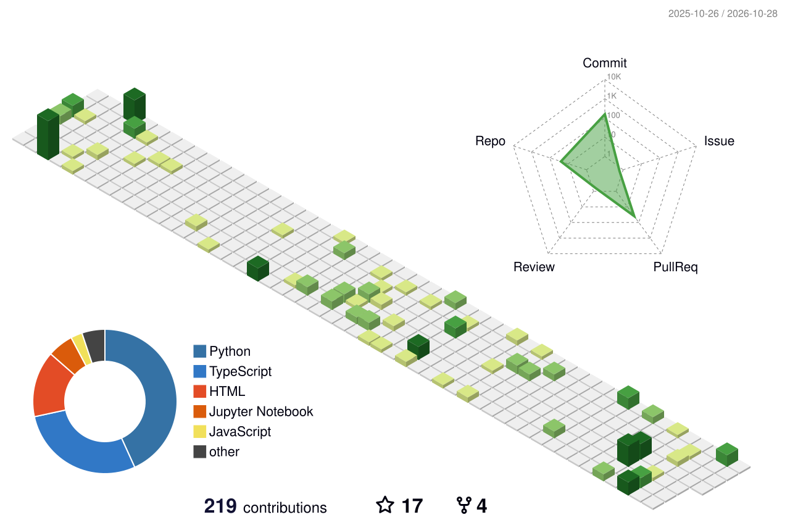

# Dr. Babajan Banaganapalli

**Associate Professor of Genetic Medicine · King Abdulaziz University**

Clinical bioinformatics &nbsp;·&nbsp; AI in genomics &nbsp;·&nbsp; Multiomics &nbsp;·&nbsp; 12+ years in research and teaching

---

### About

I build tools that take genomic data from raw reads to clinically interpretable results: NGS pipelines, variant
interpretation, QC automation, and AI-assisted analysis. My research sits where human genetics meets machine
learning, and most of what I write here is meant to be used by clinicians, students, and other researchers.

**Open to:** PhD supervision · research collaboration · bioinformatics consulting

---

### Featured projects

| Project | What it does |
|---|---|
| [**Exome-Analysis-End-to-END**](https://github.com/Babajan-B/Exome-Analysis-End-to-END) | One-command NGS pipeline: FASTQ to annotated variants |
| [**PrismBB-VCF**](https://github.com/Babajan-B/PrismBB-VCF) · [**PrismBB-CentralDogma**](https://github.com/Babajan-B/PrismBB-CentralDogma) | Genomics toolkit modules for VCF handling and sequence biology |
| [**BioQC-MCP**](https://github.com/Babajan-B/BioQC-MCP) | MCP server that brings FastQC / MultiQC reporting to AI assistants |
| [**AlphaGenome**](https://github.com/Babajan-B/AlphaGenome-AI-Powered-Genomic-Analysis-Platform) | AI-assisted genomic analysis platform |
| [**pubmed-search-engine**](https://github.com/Babajan-B/pubmed-search-engine) | PubMed search filtered to high-impact journals |
| [**phylogenetic_tree_app**](https://github.com/Babajan-B/phylogenetic_tree_app) · [**Sequence-Search-Tool**](https://github.com/Babajan-B/Sequence-Search-Tool) · [**genome-coordinate-converter**](https://github.com/Babajan-B/genome-coordinate-converter) | Everyday utilities for phylogenetics, sequence search, and genome build liftover |

More in <a href="https://github.com/Babajan-B?tab=repositories">Repositories</a>.

### Open-source contributions

**[ClawBio/ClawBio](https://github.com/ClawBio/ClawBio)** (1,000+ ★): four merged skills:
`cnv-acmg-classifier` · `phylogenetics-builder` · `pathway-enricher` · `bioqc-mcp`

---

### Tech stack

**Languages** 

**Genomics** 

**Machine learning** 

**Also published:** Android apps [Quran Urdu-English](https://play.google.com/store/apps/details?id=quran.urdu.english.quran5) and [Quran Telugu](https://play.google.com/store/apps/details?id=com.QuranTelugu.quran_telugu) on Google Play.

---

### GitHub activity

<picture>
  <source media="(prefers-color-scheme: dark)" srcset="profile-3d-contrib/profile-night-rainbow.svg" />
  <source media="(prefers-color-scheme: light)" srcset="profile-3d-contrib/profile-green.svg" />
  
</picture>

Generated daily by a GitHub Action in this repository.
